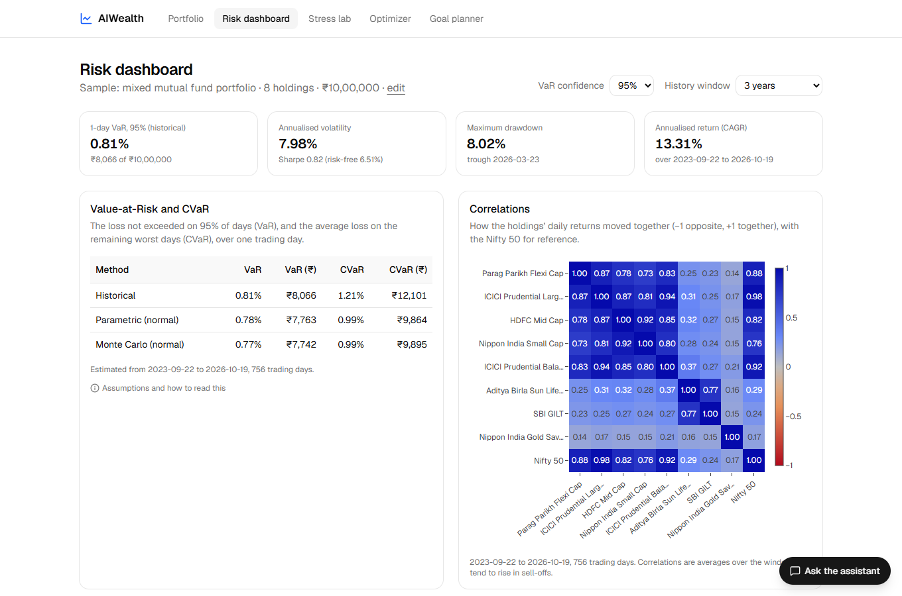
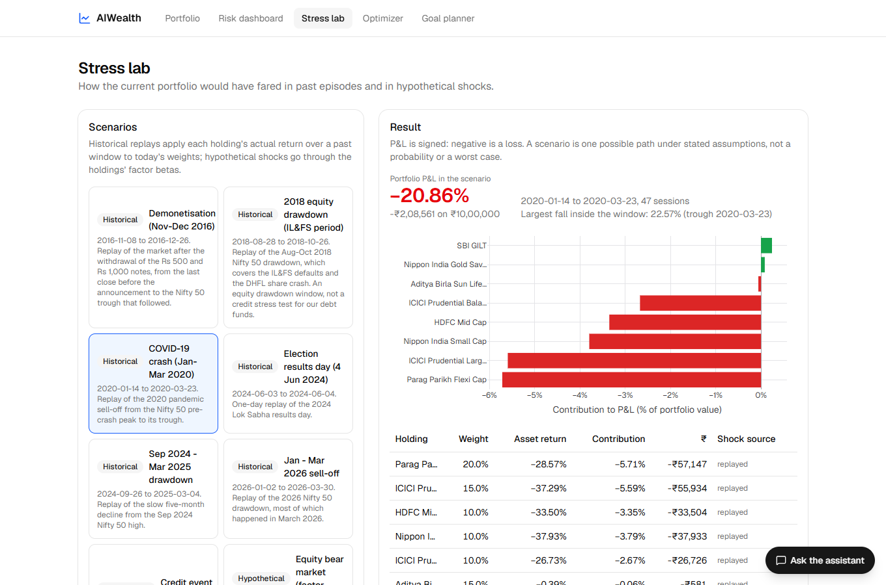
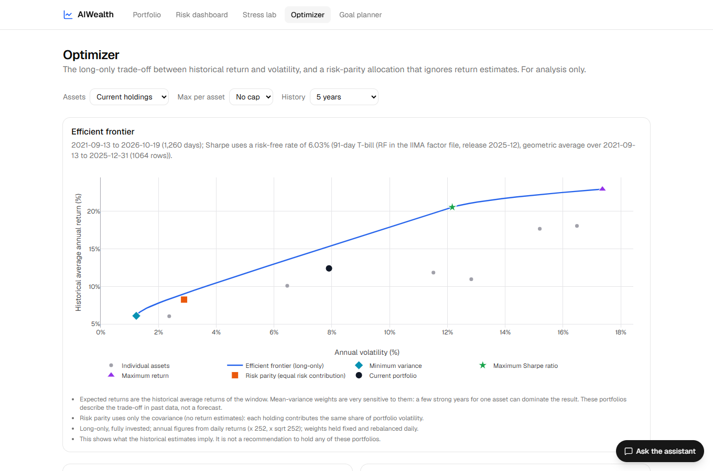
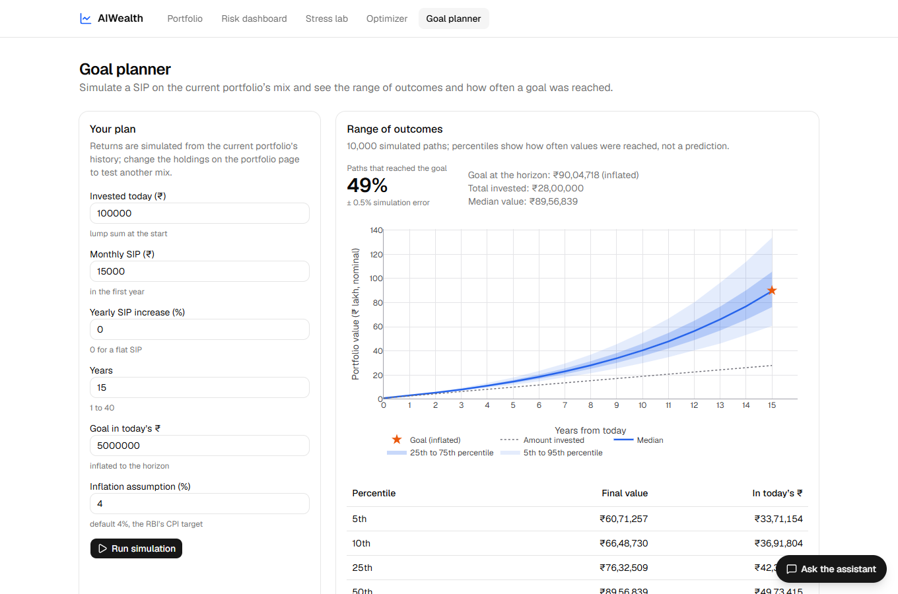
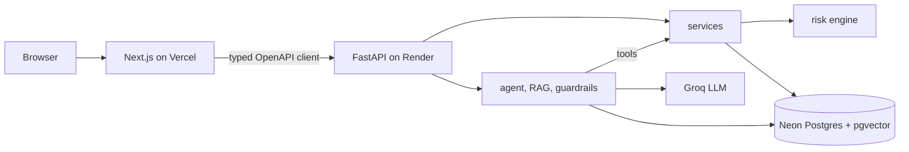

# AIWealth

**Portfolio risk analytics and goal planning for Indian mutual funds and Nifty stocks, with an AI
assistant that explains the numbers without making them up.**

Live demo: _(link to be added after deployment)_ · API docs: _(link)_/docs

## What it does

| Page | What you get |
|---|---|
| **Portfolio** | Search 15 mutual funds, 20 Nifty 50 stocks and the Nifty 50; enter holdings in rupees, upload a CSV, or load a sample (no login) |
| **Risk dashboard** | VaR and CVaR (historical, parametric, Monte Carlo) in % and rupees; return, volatility, Sharpe, Sortino, drawdowns; correlation heatmap; each holding's share of risk (Euler decomposition); Carhart factor exposures on IIM Ahmedabad's Indian factors; rolling VaR backtest with Kupiec, Christoffersen and Basel traffic light |
| **Stress lab** | Replays of real episodes (COVID crash, demonetisation, 2024 election day, 2026 sell-off, ...), hypothetical factor/sector/category shocks, or a scenario described in words |
| **Optimizer** | Long-only efficient frontier, minimum variance, maximum Sharpe, risk parity, compared with the current portfolio |
| **Goal planner** | Monte Carlo SIP simulation (GBM calibrated on log returns): probability of reaching an inflation-adjusted goal, range of outcomes; an illustrative risk-profile questionnaire |
| **Assistant** | Ask questions in plain English. It answers from the risk engine (tool calls) and from public fund and SEBI documents (cited by page), and shows which tools it used |

Everything is informational: the app describes past behaviour under stated assumptions and never
tells anyone what to buy or sell.

| Stress lab | Optimizer | Goal planner |
|---|---|---|
|  |  |  |

## Inspiration and scope

Inspired by the idea behind BlackRock's Aladdin Wealth: one consistent view of risk across a client's holdings, plus goal tracking for advisors. This is an independent student project. It covers a small slice (analytics for mutual funds and large-cap stocks), not trading, operations or institutional scale. It is not affiliated with BlackRock.

## How the numbers stay honest

1. **A deterministic engine computes every figure.** `app/engine` is pure numpy/pandas: no I/O,
   no network, no LLM. Every function documents its formula, units and assumptions
   ([docs/methodology.md](docs/methodology.md)), and tests use analytically known answers.
2. **The LLM never computes numbers.** It calls tools that return pre-formatted figures, and a
   numeric-grounding check verifies that every number in its answer appears in a tool output or
   a retrieved document; failures get one repair turn and are otherwise flagged to the user.
3. **No external calls on a request path.** Market data is downloaded by seed scripts, cached,
   and copied into Postgres; requests read the cache.
4. **Everything is evaluated.** `make eval` measures retrieval, answers, tool selection and VaR
   backtests, and only its output is quoted below.

## Evaluation results

_Filled from `eval/results/summary.md` (produced by `make eval`)._

<!-- EVAL:START -->
Generated 2026-10-25 09:39 UTC by `eval/run_eval.py`. Model: `openai/gpt-oss-120b`. The golden set (`eval/golden_qa.jsonl`) is still a draft awaiting review;
re-run `make eval` after editing it.

### Retrieval (49 answerable questions, 2,388 chunks)

| Configuration | hit@1 | hit@3 | hit@5 | MRR@10 | latency |
|---|---|---|---|---|---|
| dense | 36.7% | 46.9% | 61.2% | 0.449 | 8 ms |
| dense+fund_filter | 40.8% | 55.1% | 67.3% | 0.502 | 12 ms |
| hybrid | 34.7% | 59.2% | 63.3% | 0.480 | 21 ms |
| hybrid+fund_filter | 38.8% | 61.2% | 67.3% | 0.513 | 18 ms |
| hybrid_rerank | 49.0% | 63.3% | 65.3% | 0.578 | 964 ms |
| hybrid_rerank+fund_filter | 51.0% | 69.4% | 75.5% | 0.627 | 3019 ms |

### Answers (hybrid_rerank, 49 answerable + 10 unanswerable)

| Metric | Value |
|---|---|
| Key facts present, strict phrase match (answerable) | 53.1% |
| Key facts present, lenient match (answerable; see eval/README) | 61.2% |
| Key facts present when a gold page was retrieved | 64.9% |
| Citations valid (answered questions) | 97.4% |
| Cites a gold page (answerable) | 63.3% |
| Numbers grounded in passages (all) | 98.3% |
| Correct abstention (unanswerable) | 100.0% |
| False abstention (answerable) | 22.4% |
| Faithful (LLM judge, 36 judged answers) | 100.0% |

### Tool calls (36 cases)

- Correct tool: 97.2%
- Correct tool and arguments: 88.9%

- Grading note, t18: Ambiguous by design (decided 2026-10-25): the committed it_sector_shock scenario and a custom IT-sector shock both answer it; either counts.

### VaR backtest (returns to 2026-10-19; rolling 504-day window, 1-day VaR)

| Portfolio | Conf | Method | Test days | Expected | Breaches | Rate | Kupiec p | Christoffersen p_ind | Basel (last 250) | Matches docs |
|---|---|---|---|---|---|---|---|---|---|---|
| ^NSEI | 95% | historical | 2405 | 120.3 | 126 | 5.2% | 0.593 | 0.001 | – | yes |
| ^NSEI | 95% | parametric | 2405 | 120.3 | 115 | 4.8% | 0.621 | 0.001 | – | yes |
| ^NSEI | 95% | monte_carlo | 2405 | 120.3 | 117 | 4.9% | 0.760 | 0.002 | – | yes |
| ^NSEI | 99% | historical | 2405 | 24.1 | 30 | 1.2% | 0.240 | 0.000 | 5 yellow | yes |
| ^NSEI | 99% | parametric | 2405 | 24.1 | 41 | 1.7% | 0.002 | 0.001 | 6 yellow | yes |
| ^NSEI | 99% | monte_carlo | 2405 | 24.1 | 39 | 1.6% | 0.005 | 0.000 | 6 yellow | yes |
| EW20 | 95% | historical | 2405 | 120.3 | 128 | 5.3% | 0.473 | 0.004 | – | yes |
| EW20 | 95% | parametric | 2405 | 120.3 | 119 | 4.9% | 0.907 | 0.002 | – | yes |
| EW20 | 95% | monte_carlo | 2405 | 120.3 | 118 | 4.9% | 0.833 | 0.002 | – | yes |
| EW20 | 99% | historical | 2405 | 24.1 | 26 | 1.1% | 0.693 | 0.000 | 4 green | yes |
| EW20 | 99% | parametric | 2405 | 24.1 | 36 | 1.5% | 0.023 | 0.118 | 4 green | yes |
| EW20 | 99% | monte_carlo | 2405 | 24.1 | 36 | 1.5% | 0.023 | 0.118 | 4 green | yes |
<!-- EVAL:END -->

## Architecture

Router -> service -> engine/data, with the AI layer above the services; the import rules are
enforced by a test. Details: [docs/architecture.md](docs/architecture.md). API reference:
[docs/api.md](docs/api.md). Data sources and their limitations: [docs/data.md](docs/data.md).

## Tech stack

Python 3.12, FastAPI, Pydantic, SQLAlchemy, Alembic, PostgreSQL (Neon) with pgvector, numpy,
pandas, fastembed (ONNX embeddings and reranker), pypdf, Groq (OpenAI-compatible API), Next.js 16,
TypeScript, Tailwind, shadcn/ui, Plotly, Zustand, pytest, vitest, ruff, ESLint, GitHub Actions.

## Development

Requires Python 3.12, Node 24 and a Postgres database with pgvector. The project uses a hosted
[Neon](https://neon.tech) Postgres (free tier) by default, so Docker is **not** required;
`docker-compose.yml` is an optional local Postgres. Copy `.env.example` to `.env` and set
`DATABASE_URL` (and `GROQ_API_KEY` for the assistant).

On Windows, run these in PowerShell from the repo root (`make <target>` does the same elsewhere):

| Make target | PowerShell equivalent |
|---|---|
| `make install` | `cd apps/api; python -m pip install -e ".[dev]"` |
| `make lint` | `cd apps/api; ruff check .; ruff format --check .` |
| `make test` | `cd apps/api; pytest` |
| `make seed` | `python scripts/seed_data.py` (download market data into the Parquet cache) |
| `make migrate` | `cd apps/api; alembic upgrade head` |
| `make seed-db` | `python scripts/seed_db.py` (copy the cache into Postgres) |
| `make ingest-docs` | `python scripts/ingest_docs.py --db` (download, verify and embed the documents) |
| `make api` | `cd apps/api; uvicorn app.main:app --reload` |
| `make eval` | `python eval/build_golden.py; python eval/run_eval.py --answers-mode hybrid_rerank --judge` |
| `make infra-up` | `docker compose up -d postgres` (optional, instead of Neon) |

Web app: `cd apps/web; npm install; npm run dev` (checks: `npm run lint`, `npm run typecheck`,
`npm test`, `npm run build`). After changing an API schema: `python scripts/export_openapi.py`
then `npm run gen:api`.

Unit tests need no network or database (synthetic data, SQLite in memory, fake LLM). Tests marked
`postgres` run against `DATABASE_URL` in a throwaway schema and are skipped when it is not set.

## Deployment

The API runs as a Docker web service on Render (`render.yaml`, `apps/api/Dockerfile`), the web
app on Vercel (`apps/web`, root directory), and the database on Neon. Secrets are set only in
the hosts' dashboards. The free API instance sleeps when idle; the web app shows a "waking up"
state while it starts.

## Data and licences

- Mutual fund NAVs from [mfapi.in](https://www.mfapi.in/) (AMFI data); NSE prices and the Nifty 50
  from Yahoo Finance; Indian Fama-French-Carhart factors from IIM Ahmedabad: Agarwalla, S. K.,
  Jacob, J. and Varma, J. R. (2013), *Four factor model in Indian equities market*, IIMA Working
  Paper 2013-09-05. The factor file has no stated licence, so it is never committed or published;
  only derived results are shown, with this citation.
- Fund and regulatory PDFs are public documents from SEBI, AMFI and the fund houses; they are
  downloaded by a script and never committed.
- Known limitations (survivorship bias in today's fund and index lists, a price-only Nifty 50
  benchmark, data gaps) are documented in [docs/data.md](docs/data.md).

## Disclaimer

For education and information only. Not investment advice. Not affiliated with any fund house,
SEBI, AMFI or BlackRock.

## Author

Nirdosh Kumar
