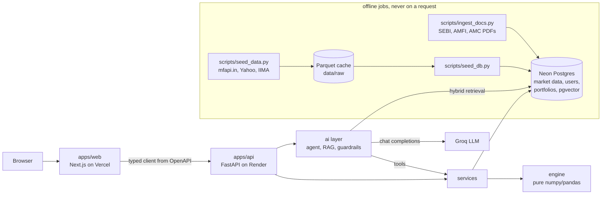

# Architecture

## Overview



## Components

- **apps/web**: Next.js 16 (App Router), TypeScript strict, Tailwind, shadcn/ui, Plotly, Zustand.
  Pages: landing (no-login demo), portfolio input, risk dashboard, stress lab, optimizer, goal
  planner, assistant panel. API types are generated from the OpenAPI spec.
- **apps/api**: FastAPI
  - `app/api`: HTTP routers (thin). `/health` and `/api/v1/*`
  - `app/services`: orchestration; `MarketData` is loaded once per process and held in memory
  - `app/engine`: deterministic risk engine (no LLM, no network, no I/O)
  - `app/ai`: LLM client, tool-calling agent, RAG, guardrails, evaluation scoring
  - `app/data`: providers (seed scripts only), Parquet cache, SQL repositories
  - `app/db`: SQLAlchemy models and sessions; migrations in `alembic/`
  - `app/schemas`: Pydantic request/response models
- **Neon Postgres + pgvector**: users, saved portfolios, cached prices and factor returns,
  document chunks with embeddings (HNSW cosine index).
- **In-process caches** (no Redis): market data in memory, LRU cache for backtests, chat rate
  limiting, lazily loaded embedding model.

## Dependency rules (enforced by `tests/test_architecture.py`)

1. `app.engine` imports nothing else from the app, no web framework, ORM or network library.
2. `app.ai.agent.tools` is the only module of the AI layer that touches the engine, and it goes
   through services. Nothing below the AI layer imports it.
3. Request flow: router -> service -> engine/data. The AI layer sits above the services:
   api -> ai -> services -> engine/data. Routers never import the engine or the data layer.
4. No external call on a user request path for market data: providers are imported only by the
   seed path; requests read Postgres or the Parquet cache. (The chat endpoint calls the LLM.)

## A request

```
POST /api/v1/risk/var {portfolio, confidence, lookback_days}
  -> Pydantic VaRRequest: long-only, unique ids, weights sum to 1 (renormalised)
  -> MarketDataStore.get(): aligned prices + returns, loaded once per process
  -> services.risk.var_report: check assets, take the window, call the engine
  -> engine.risk.var: historical / parametric / Monte Carlo
  -> VaRResponse: positive loss fractions and rupees, window, notes
Errors: engine ValueError -> AnalyticsInputError -> 422; missing data -> 503.
```

## AI layer (`app/ai/`)

```
POST /ai/chat --> ai.service.chat_events --> agent.loop.run_agent
                                               |  messages = [system prompt, history]
                                               |  repeat (max 6 steps):
                                               |    LLMClient.chat(messages, tool schemas)
                                               |    tool calls? -> agent.tools.execute -> app.services -> engine
                                               |               or search_knowledge_base -> retriever (sanitised passages)
                                               |    else: answer -> guardrails
                                               |           fails grounding/compliance? one repair turn
                                               |           -> citations, flags, disclaimer -> stop
                                               +- events streamed as SSE; every step in ai.trace (JSONL)
```

- **LLMClient** (`ai/llm/base.py`): one method, OpenAI chat-completions shapes. Implementations:
  `OpenAICompatibleClient` (httpx; Groq by default; backoff on 429/5xx; `ToolUseFailed` for a
  provider-rejected tool call, which the loop feeds back to the model once), `FakeLLMClient`
  (tests), `CachedLLMClient` (disk cache for eval). Provider = settings (`LLM_BASE_URL`,
  `LLM_MODEL`, `LLM_API_KEY`/`GROQ_API_KEY`).
- **Tools** (`ai/agent/tools.py`): risk summary, risk contributions, factor exposures, VaR
  backtest, list/run stress scenarios, custom stress, optimizer, goal simulation, knowledge-base
  search. Outputs are compact and carry **display strings** the model must copy verbatim; the
  portfolio comes from the request, never from the model's arguments.
- **RAG** (`ai/rag/`): verified PDF corpus, page-exact chunks, bge-small embeddings, BM25 + RRF,
  optional cross-encoder rerank, fund filter, `[doc p.N]` citations checked against what was
  retrieved. See docs/methodology.md, "Knowledge base and retrieval".
- **Guardrails** (`ai/guardrails.py`): numeric grounding, compliance filter, prompt-injection
  filter on retrieved text. See docs/methodology.md, "Guardrails".
- **Why the answer is not streamed token by token:** the guardrails need the complete answer
  before anything is shown. Progress (tool calls and results) is streamed.

## Deployment topology

| Piece | Where | Notes |
|---|---|---|
| Web | Vercel (`apps/web`) | static shells + client-side data; `NEXT_PUBLIC_API_URL` at build time |
| API | Render free web service, Docker (`apps/api/Dockerfile`, `render.yaml`) | runs `alembic upgrade head` then uvicorn; embedding model baked into the image; sleeps when idle (cold start: the UI polls `/status`) |
| Database | Neon free Postgres with pgvector | market data, users, portfolios, document chunks |
| LLM | Groq free tier (OpenAI-compatible) | rate-limited chat endpoint |

CORS allows only `CORS_ORIGINS` (the Vercel domain). Secrets (`DATABASE_URL`, `GROQ_API_KEY`,
`JWT_SECRET`) live only in the hosts' environment settings.

## Data refresh

Market data changes daily but the platform does not need intraday freshness:

1. `python scripts/seed_data.py` downloads into the Parquet cache (mfapi.in, Yahoo, IIMA factors).
2. `python scripts/seed_db.py` copies the cache into Postgres.
3. The API picks up new data on its next start (each process loads market data once).

This is run by hand for now; a scheduled job (e.g. a weekly GitHub Action with the database
secret) is a possible extension. The IIMA factor file is never uploaded anywhere public: only
derived factor returns go to the (private) database, and results cite the source.
